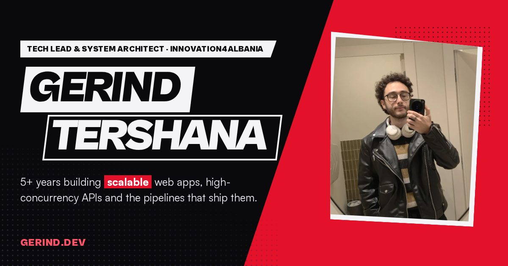
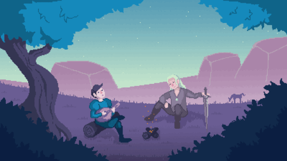

# gerind.dev

My portfolio. I'm Gerind, a software engineer in Tirana. This is where I put the stuff I've built,
what I'm reading and watching, and the places I've been.

Live at https://gerind.dev



## What's in it

- **Home:** a calling-card hero, a ticker, the keyboard-driven "Where to?" menu with a live preview, selected work and a contact card.
- **Projects:** pause-menu tabs for Personal & freelance, Innovation4Albania, Detag, Friends' sites and Early days (switch with ←/→ or Q/E). Pictured work gets a poster, the rest a compact row.
- **About:** profile, tools, career plates, education and a spinning globe of visited countries.
- **Media:** books, movies and manga I keep coming back to.
- **Photos:** a photography gallery. It only appears once there are photos in `src/assets/photos/`.
- **Extras:** accent colour picker, dark and light mode, optional menu sound, keyboard shortcuts (press `?`, can be switched off in Style), a mascot swap on the hero, scroll reveals and cross-document view transitions. Everything respects reduced motion.

The look is inspired by Persona 5's calling cards: ink black, one accent colour, slanted paper cut-outs. I drew it all myself, no game art or logos.

## Stack

- [Astro](https://astro.build) 4, static output, served from Cloudflare Workers static assets at [gerind.dev](https://gerind.dev)
- UnoCSS reset plus hand-written CSS in `src/style.css`
- Solid (globe) and d3 for the map
- Self-hosted Cabinet Grotesk and Satoshi (woff2)

## Run it locally

```sh
git clone https://github.com/GerindT/gerind-bento.git
cd gerind-bento
pnpm install
pnpm dev        # http://localhost:4321
pnpm build      # static site in dist/
pnpm preview    # serve the build
```

## Where to change things

| To change | Edit |
| --- | --- |
| Projects | `src/lib/projects.ts` (each one has a `group`, a one-line `blurb`, an optional `role` and the live `site`; screenshots go in `public/illustrations/projects/` as 1280×800 WebP, with a `.webp.json` note of where each came from) |
| Career, education, languages | `src/lib/career.ts` |
| Books, movies, manga | `src/lib/media.ts` |
| Countries on the globe | `src/lib/places.ts` |
| Links, name and site URL | `src/lib/constants.ts` |
| Photos | drop images in `src/assets/photos/` and describe them in `src/lib/photos.ts` |
| CV PDFs | replace `public/Gerind_Tershana_EN.pdf` and `public/Gerind_Tershana_AL.pdf` |
| Share image | regenerate `public/og.png` (1200×630) after big hero changes |
| Colours and theme | CSS variables at the top of `src/style.css` |

## Project layout

```
src/
  assets/photos/     photography (optional)
  components/        header, footer, poster card, project row, theme picker, globe
  layouts/           BasicLayout (head, SEO, structured data) and Layout
  lib/               data and helpers
  pages/             index, projects, about, media, photos, 404
public/              fonts, CVs, gifs, illustrations, icons, _headers, _redirects
```

## Deploy

`pnpm run deploy` builds with Astro and uploads `dist/` to the `gerind` Worker (static assets only, see `wrangler.jsonc`; the custom domain is gerind.dev). Run `npx wrangler login` once first. `wrangler.jsonc` pins my own Cloudflare account, so the deploy never asks which account to use when the login also has access to a client's. Caching rules live in `public/_headers` and redirects in `public/_redirects`. The old Netlify site only redirects to gerind.dev (`netlify.toml`).

## Obligatory GIF


